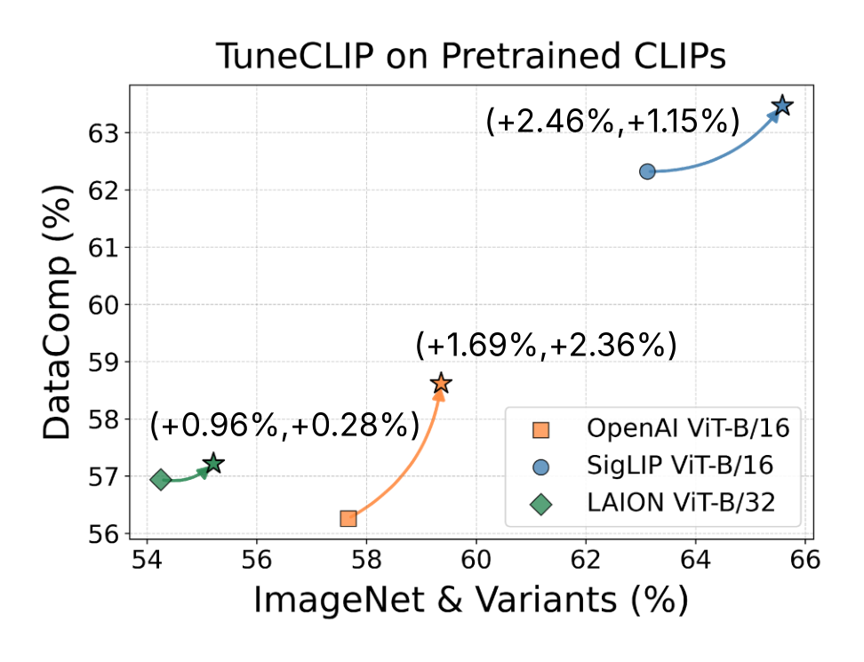
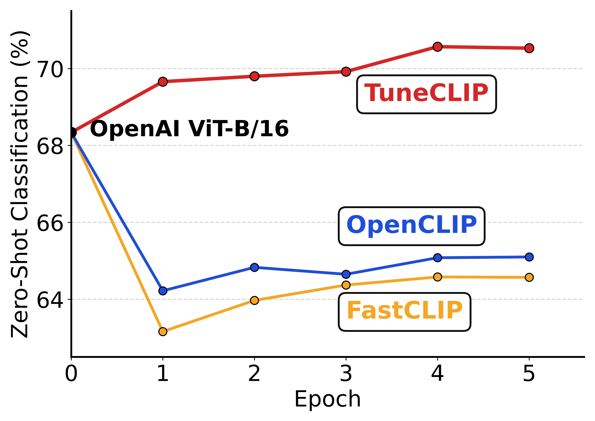

# Tune-Up Open-Weight CLIP: Optimization Framework for Self-Supervised Fine-tuning of CLIP

**Accepted as a NeurIPS 2026 Spotlight**

TuneCLIP is a two-stage optimization framework for self-supervised fine-tuning (SSFT) of open-weight CLIP models. It first recovers the optimizer statistics at the pretrained solution with **Optimizer Statistics Recovery (OSR)**, then fine-tunes the model with **Hinged Global Contrastive Learning (HGCL)**.

<p align="center">
  
</p>

## Why TuneCLIP?

Standard Self-supervised fine-tuning can immediately degrade a pretrained CLIP model. TuneCLIP fixes this mismatch and leads to improvements right from first epoch.

<p align="center">
  
</p>

## Method

Below are instructions to run the two stages:

### Stage 1: Optimizer Statistics Recovery (OSR)

OSR addresses cold-start bias without changing the pretrained model:

- Keep the model parameters fixed at `ω₀`.
- Run the SogCLR/FastCLIP update computation over the self-supervised dataset.
- Recover the Adam first moment `m`, second moment `v`, and statistics such as `uᵢ,ₓ` and `uᵢ,𝓏`.
- Do not apply parameter updates during this stage (`--lr 0.0` in the supplied script).

The recovered `m`, `v`, `uᵢ,ₓ`, and `uᵢ,𝓏` values are saved in the Stage 1 checkpoint and initialized into Stage 2. In the paper, five OSR epochs are sufficient for stable subsequent fine-tuning.

### Stage 2: Hinged Global Contrastive Learning (HGCL)

Web-scale image-text data contains **false negatives**: an image and a non-matching caption in the batch may still be semantically related. Standard GCL keeps pushing every negative similarity below the positive similarity, which can distort useful pretrained representations.

HGCL replaces the linear pairwise penalty with a squared hinge surrogate. The same form is used for text-anchored pairs. Therefore, a negative receives no gradient once it is sufficiently below the positive similarity.

The margin controls the trade-off between retaining semantically related false negatives and separating true negatives. TuneCLIP resumes the OSR checkpoint and enables HGCL with `--hinge_sogclr`, using `m = 0.1` and `margin_smoothing = 2` in the supplied recipe.

## Installation

Create a training environment from the repository root:

```bash
pip install -r requirements-training.txt
```

For evaluation, install the evaluation dependencies instead (or in a separate environment):

```bash
pip install -r requirements-eval.txt
```

## Training

Before submitting either job, update the project directory, dataset paths, checkpoint paths, environment name, and SLURM directives in the scripts.

### Stage 1: OSR

`Scripts_TuneCLIP/run_osr.sh` starts from an OpenAI ViT-B/16 checkpoint and recovers optimizer statistics while keeping the model weights fixed.

```bash
sbatch Scripts_TuneCLIP/run_osr.sh
```

The essential command is:

```bash
srun python -u src/training/main.py \
  --save-frequency 1 \
  --train-data "/path/to/data.tar" \
  --pretrained openai \
  --train-num-samples 12025856 --data_size 19280000 \
  --warmup 500 --batch-size 256 --epochs 5 --workers 6 \
  --model ViT-B-16 --name TuneCLIP_OSR_openai_vitb16 \
  --seed 2025 --wd 0.02 --local-loss \
  --fastclip --multiply_tau --temperature_scheme global_constant \
  --lr 0.0 --lr_tau 7.8125e-5 --lr_tau_scheduler step_thresh --rho 11.0 \
  --gamma 0.9 --gamma_schedule cosine --gamma_decay_epochs 4
```

### Stage 2: OSR + HGCL

Set `--resume` to the Stage 1 checkpoint, then submit. This restores both model weights and the optimizer/statistical state recovered by OSR:

```bash
sbatch Scripts_TuneCLIP/run_hgcl.sh
```

The essential command is:

```bash
srun python -u src/training/main.py \
  --save-frequency 1 --hinge_sogclr \
  --margin 0.1 --margin_schedule constant --margin_smoothing 2 \
  --train-data "/path/to/data.tar" \
  --resume "/path/to/checkpoints/epoch_5.pt" \
  --train-num-samples 12025856 --data_size 19280000 \
  --warmup 500 --batch-size 256 --epochs 10 --workers 6 \
  --model ViT-B-16 --name TuneCLIP_final_vitb16_openai \
  --seed 2025 --wd 0.02 --local-loss \
  --fastclip --multiply_tau --temperature_scheme global_constant \
  --lr 1e-5 --lr_tau 7.8125e-5 --lr_tau_scheduler step_thresh --rho 11.0 \
  --gamma 0.9 --gamma_schedule cosine --gamma_decay_epochs 4
```

## DataComp evaluation

After training, edit `evaluation/slurm_evaluate.sh` with the project, output, dataset, model, and checkpoint paths. Then run:

```bash
cd evaluation
sbatch slurm_evaluate.sh
```

The evaluation script invokes:

```bash
python evaluate.py \
  --train_output_dir "/path/to/your/project/train_output_dir" \
  --data_dir "/path/to/your/project/datasets/datacomp" \
  --model ViT-B-32 \
  --task datacomp \
  --use_model "ViT-B-32 /checkpoints/sample.pt"
```

Results are written under the selected output directory as `<task>.jsonl`.

## Repository structure

```text
Scripts_TuneCLIP/
├── run_osr.sh       # Stage 1: OSR warm-up
└── run_hgcl.sh      # Stage 2: OSR + HGCL
evaluation/
└── slurm_evaluate.sh
src/
└── training/
```

## Citation

```bibtex
@article{mehta2026breaking,
  title={Breaking the Limits of Open-Weight CLIP: An Optimization Framework for Self-supervised Fine-tuning of CLIP},
  author={Mehta, Anant and Wei, Xiyuan and Chen, Xingyu and Yang, Tianbao},
  journal={arXiv preprint arXiv:2601.09859},
  year={2026}
}
```
